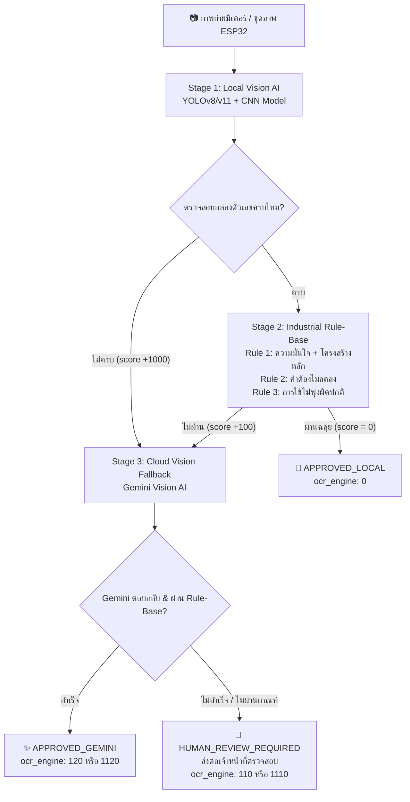

# ⚡ Smart Utility Meter OCR System

ระบบอ่านและตรวจสอบตัวเลขมิเตอร์สาธารณูปโภคอัตโนมัติ (ไฟฟ้า, น้ำ, แก๊ส) ด้วยการผสมผสานสถาปัตยกรรม **Multi-Stage AI** (Local Edge AI + Rule-Base Validation + Cloud Vision AI) พร้อมระบบ Worker ดึงคิวงานประมวลผลอัตโนมัติ (OCR Client Poller)

---

## 🌟 ฟีเจอร์เด่น (Key Features)

- **รองรับมิเตอร์ 3 ประเภทหลัก:**
  - ⚡ **มิเตอร์ไฟฟ้า (`elec`):** มาตรฐาน 5 หลัก
  - 💧 **มิเตอร์น้ำ (`water`):** รองรับทั้ง 4, 5, 7, 8 หลัก (พร้อมระบบแยกวงล้อทศนิยมสีแดง)
  - 💨 **มิเตอร์แก๊ส (`gas`):** มาตรฐาน 8 หลัก
- **ประมวลผลแบบชุดภาพ (ESP32 Multi-Image Voting):** รองรับภาพถ่าย 3 รูปต่อรอบ พร้อมอัลกอริทึม **Majority Vote** เลือกคำตอบที่มีมติเอกฉันท์
- **วิเคราะห์กลไกฟันเฟืองมิเตอร์ (Mechanical Gear Logic):** ตรวจจับตัวเลขที่กำลังหมุนเปลี่ยนผ่าน (Transition / Rolling digit)
- **ระบบตรวจสอบ 3 กฎเหล็กอุตสาหกรรม (Industrial Rule-Based Validation):**
  - **Rule 1 (Completeness & Confidence):** จำนวนหลักต้องครบตามสเปก และความมั่นใจต้องผ่านเกณฑ์
  - **Rule 2 (Non-Decreasing):** ค่าน้ำ/ค่าไฟต้องไม่ลดลงเมื่อเทียบกับประวัติเดือนก่อนหน้า
  - **Rule 3 (Usage Anomaly Guard):** อัตราการใช้ต้องไม่พุ่งสูงผิดปกติเกินกำหนด (เทียบกับค่าเฉลี่ยย้อนหลัง)
- **ระบบป้องกันการติดกระดุมผิดเม็ด (Day 0 Baseline Guard):** เพิ่มเกณฑ์ความเข้มงวดในภาพแรกของมิเตอร์ใหม่ ป้องกันการบันทึกค่าตั้งต้นที่ผิดพลาดเข้าสู่ฐานข้อมูล
- **ระบบกู้ภาพอัจฉริยะ (Gemini Vision Cloud Fallback):** หาก Local AI อ่านไม่ชัดเจน หรือตรวจไม่ผ่านเกณฑ์ ระบบจะส่งภาพให้ Gemini ช่วยอ่านกู้ผลลัพธ์อัตโนมัติ โดยส่งค่าตัวเลขต่อเนื่องครบทุกหลักและไม่ตัดเลขศูนย์นำหน้า
- **ระบบคะแนนแบบรวม (Summation Score Engine):** แจกแจงสถานะการอ่านอย่างโปร่งใสว่าผ่านด่านใดและใช้โมเดลตัวไหนตัดสิน

---

## 🏗️ สถาปัตยกรรมระบบ (Multi-Stage Pipeline)



---

## 📊 รหัสเครื่องยนต์และสถานะผลลัพธ์ (`ocr_engine`)

ระบบใช้การคำนวณคะแนนสะสมแบบ **Summation Score** เพื่อบอกที่มาของการอ่านผลลัพธ์ได้อย่างแม่นยำ:

| ค่า `ocr_engine` | ความหมาย | สถานะระบบ |
| :---: | :--- | :---: |
| **0** | **Local AI ผ่านสมบูรณ์ 100%:** YOLO หากล่องครบ + CNN อ่านชัด + ผ่านทุกกฎ | `APPROVED_LOCAL` |
| **120** | **Gemini กู้สำเร็จ:** YOLO เจอกล่องครบ แต่ตัวเลขไม่ชัดเจน/ไม่ผ่านกฎ $\rightarrow$ Gemini เข้ามาช่วยอ่านกู้สำเร็จ | `APPROVED_GEMINI` |
| **1120** | **Gemini กู้สำเร็จ:** YOLO เจอกล่องไม่ครบ (+1000) แต่ Gemini สามารถตรวจจับและอ่านค่าได้ถูกต้อง | `APPROVED_GEMINI` |
| **110** | **ส่งคนตรวจ:** YOLO หากล่องครบ แต่ไม่ผ่านเกณฑ์ Rule-Base และ Gemini ไม่สามารถกู้ได้ | `HUMAN_REVIEW_REQUIRED` |
| **1110** | **ส่งคนตรวจ:** YOLO หากล่องไม่ครบ/อ่านไม่ออก และ Gemini ไม่สามารถยืนยันผลได้ | `HUMAN_REVIEW_REQUIRED` |

---

## 📁 โครงสร้างโปรเจกต์ (Project Structure)

```text
├── best.pt                       # โมเดล YOLOv8/v11 ตรวจจับช่องตัวเลขมิเตอร์
├── dig-class100-*.tflite         # โมเดล CNN จำแนกตัวเลขและสถานะการหมุนของเฟือง
├── main_pipeline.py              # ตัวขับเคลื่อนหลัก Multi-Stage Pipeline & Majority Vote
├── meter_validator.py            # Rule-Base Engine ตรวจสอบ 3 กฎเหล็ก
├── gemini_verifier.py            # ตัวเชื่อมต่อ Gemini Vision API (Google GenAI)
├── ocr_client_poller.py          # Worker ดึงคิวงานจาก Image Store Server ผ่าน REST API
├── Dockerfile                    # Docker Image build configuration
├── docker-compose.yml            # Docker Compose configuration สำหรับรัน Worker อัตโนมัติ
├── requirements.txt              # รายการแพ็กเกจ Python สำหรับรันระบบ
└── .env.example                  # ตัวอย่างไฟล์ตั้งค่าคอนฟิกูเรชัน
```

---

## 🚀 การติดตั้งและเริ่มต้นใช้งาน (Getting Started)

### 1. ติดตั้งแบบ Local Environment

#### ความต้องการขั้นต่ำ:
- Python 3.10 ขึ้นไป
- ติดตั้งไลบรารีระบบ: `libgl1`, `libglib2.0-0`

```bash
# โคลน Repository
git clone https://github.com/kittikhun002/OCR-SERVER.git
cd OCR-SERVER

# สร้างและเปิดใช้งาน Virtual Environment
python3 -m venv venv
source venv/bin/activate  # บน Windows: venv\Scripts\activate

# ติดตั้ง Dependencies
pip install --upgrade pip
pip install -r requirements.txt
```

#### การตั้งค่าสภาพแวดล้อม (`.env`):
คัดลอกไฟล์ตัวอย่างและแก้ไขค่า:
```bash
cp .env.example .env
```

แก้ไขข้อมูลใน `.env`:
```ini
# URL เซิร์ฟเวอร์จัดเก็บภาพ
IMAGE_STORE_BASE_URL=https://cfo.ntplc.co.th/iot
IMAGE_STORE_VERIFY_TLS=true

# คีย์ยืนยันตัวตน Worker (X-OCR-Key)
OCR_API_KEY=your_ocr_api_key_here

# ความถี่ในการวนลูปตรวจจับงานใหม่ (วินาที)
POLL_INTERVAL_SECONDS=10
BATCH_SIZE=20

# การตั้งค่า Gemini API
GEMINI_API_KEY=your_gemini_api_key_here
GEMINI_MODEL=gemini-3.5-flash-lite
```

---

### 2. การสั่งงานผ่าน Command Line (CLI)

#### ทดสอบอ่านภาพเดี่ยว:
```bash
python main_pipeline.py elec/e8.jpg --type elec
```

#### ทดสอบอ่านแบบชุดภาพ (ESP32 Multi-Image):
```bash
python main_pipeline.py img1.jpg img2.jpg img3.jpg --type elec
```

---

### 3. การรันระบบประมวลผลคิวงานอัตโนมัติ (Worker Poller)

```bash
python ocr_client_poller.py
```

---

### 4. การติดตั้งและรันด้วย Docker / Docker Compose

รันเป็น Service แบ็กกราวนด์ที่เปิดเครื่องทำงานอัตโนมัติ:

```bash
# Build และเปิดใช้งาน Container
docker compose up -d --build

# ดู Log การประมวลผลแบบ Real-time
docker compose logs -f

# หยุดการทำงาน
docker compose down
```

---

## 🧪 การทำงานของโหมดทดสอบ (Test Mode vs Production Mode)

ระบบตรวจจับโหมดการทำงานอัตโนมัติจากชื่อไฟล์ภาพหรือ URL:
- **โหมดทดสอบ (`🧪 TEST`):** หากชื่อไฟล์มีคำว่า `test` ระบบจะ:
  - ข้ามการดึงประวัติเดิม (`history = []`)
  - รันประมวลผลด้วย Local AI โดยไม่บังคับเข้าเกณฑ์เข้มงวดวันแรก เพื่อวัดประสิทธิภาพของโมเดล YOLO ล้วนๆ
  - ส่งผลลัพธ์กลับไปยัง Endpoint ทดสอบโดยเฉพาะ
- **โหมดปฏิบัติงานจริง (`🏢 PRODUCTION`):**
  - ดึงประวัติอ่านย้อนหลังและนำเข้าสู่ Rule 2 และ Rule 3
  - มิเตอร์ใหม่ที่ยังไม่มีประวัติ จะเปิดใช้ **Day 0 Baseline Guard** (ต้องมีความมั่นใจ $\ge 0.80$ หรือส่ง Gemini ยืนยัน)

---

## 🔒 ลิขสิทธิ์และการพัฒนา (License & Contributors)

พัฒนาสำหรับระบบบริหารจัดการและจัดเก็บข้อมูลภาพถ่ายมิเตอร์อัจฉริยะ (Smart Utility Metering Infrastructure)
