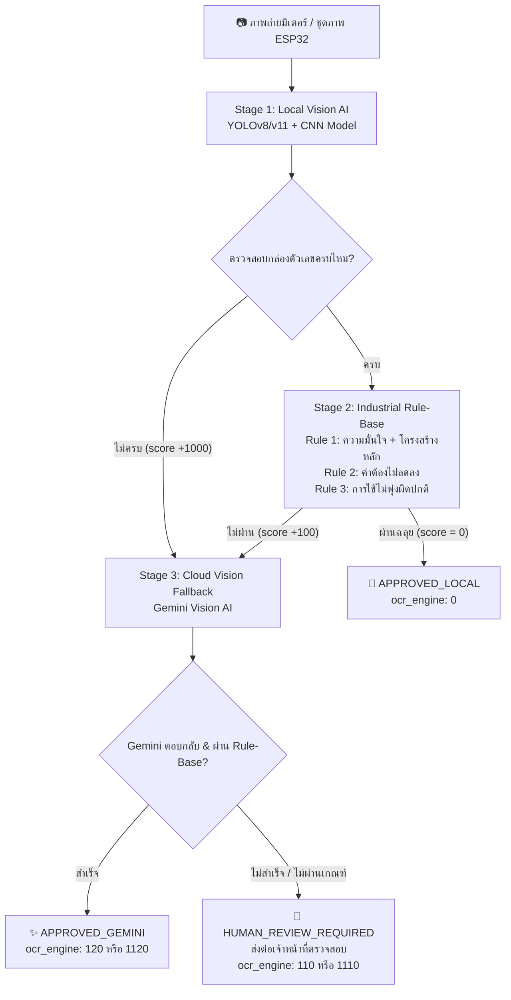

# ⚡ Smart Utility Meter OCR System

ระบบอ่านและตรวจสอบตัวเลขมิเตอร์สาธารณูปโภคอัตโนมัติ (ไฟฟ้า, น้ำ, แก๊ส) ด้วยสถาปัตยกรรม **Multi-Stage AI** (Local Edge AI + Rule-Base Validation + Cloud Vision AI) พร้อมระบบ Worker ดึงคิวงานประมวลผลอัตโนมัติ (OCR Client Poller)

---

## 🌟 ฟีเจอร์เด่น (Key Features)

- **รองรับมิเตอร์ 3 ประเภทหลัก:**
  - ⚡ **มิเตอร์ไฟฟ้า (`elec`):** มาตรฐาน 5 หลัก
  - 💧 **มิเตอร์น้ำ (`water`):** รองรับทั้ง 4, 5, 7, 8 หลัก (พร้อมระบบแยกวงล้อทศนิยมสีแดง)
  - 💨 **มิเตอร์แก๊ส (`gas`):** มาตรฐาน 8 หลัก
- **ประมวลผลแบบชุดภาพ (ESP32 Multi-Image Voting):** รองรับภาพถ่าย 3 รูปต่อรอบ พร้อมอัลกอริทึม **Majority Vote** เลือกคำตอบที่มีมติเอกฉันท์
- **วิเคราะห์กลไกฟันเฟืองมิเตอร์ (Mechanical Gear Logic):** ตรวจจับตัวเลขที่กำลังหมุนเปลี่ยนผ่าน (Transition / Rolling digit)
- **ระบบตรวจสอบ 3 กฎเหล็กอุตสาหกรรม (Industrial Rule-Based Validation):**
  - **Rule 1 (Completeness & Confidence):** จำนวนหลักต้องครบตามสเปก และความมั่นใจต้องผ่านเกณฑ์
  - **Rule 2 (Non-Decreasing):** ค่าน้ำ/ค่าไฟต้องไม่ลดลงเมื่อเทียบกับประวัติเดือนก่อนหน้า
  - **Rule 3 (Usage Anomaly Guard):** อัตราการใช้ต้องไม่พุ่งสูงผิดปกติเกินกำหนด (เทียบกับค่าเฉลี่ยย้อนหลัง)
- **ระบบป้องกันการติดกระดุมผิดเม็ด (Day 0 Baseline Guard):** เพิ่มเกณฑ์ความเข้มงวดในภาพแรกของมิเตอร์ใหม่ ป้องกันการบันทึกค่าตั้งต้นที่ผิดพลาดเข้าสู่ฐานข้อมูล
- **ระบบกู้ภาพอัจฉริยะ (Gemini Vision Cloud Fallback):** หาก Local AI อ่านไม่ชัดเจน หรือตรวจไม่ผ่านเกณฑ์ ระบบจะส่งภาพให้ Gemini ช่วยอ่านกู้ผลลัพธ์อัตโนมัติ โดยส่งค่าตัวเลขต่อเนื่องครบทุกหลักและไม่ตัดเลขศูนย์นำหน้า
- **ระบบคะแนนแบบรวม (Summation Score Engine):** แจกแจงสถานะการอ่านอย่างโปร่งใสว่าผ่านด่านใดและใช้โมเดลตัวไหนตัดสิน

---

## 🏗️ สถาปัตยกรรมระบบ (Multi-Stage Pipeline)



---

## 📊 รหัสเครื่องยนต์และสถานะผลลัพธ์ (`ocr_engine`)

ระบบใช้การคำนวณคะแนนสะสมแบบ **Summation Score** เพื่อบอกที่มาของการอ่านผลลัพธ์ได้อย่างแม่นยำ:

| ค่า `ocr_engine` | ความหมาย | สถานะระบบ |
| :---: | :--- | :---: |
| **0** | **Local AI ผ่านสมบูรณ์ 100%:** YOLO หากล่องครบ + CNN อ่านชัด + ผ่านทุกกฎ | `APPROVED_LOCAL` |
| **120** | **Gemini กู้สำเร็จ:** YOLO เจอกล่องครบ แต่ตัวเลขไม่ชัดเจน/ไม่ผ่านกฎ $\rightarrow$ Gemini เข้ามาช่วยอ่านกู้สำเร็จ | `APPROVED_GEMINI` |
| **1120** | **Gemini กู้สำเร็จ:** YOLO เจอกล่องไม่ครบ (+1000) แต่ Gemini สามารถตรวจจับและอ่านค่าได้ถูกต้อง | `APPROVED_GEMINI` |
| **110** | **ส่งคนตรวจ:** YOLO หากล่องครบ แต่ไม่ผ่านเกณฑ์ Rule-Base และ Gemini ไม่สามารถกู้ได้ | `HUMAN_REVIEW_REQUIRED` |
| **1110** | **ส่งคนตรวจ:** YOLO หากล่องไม่ครบ/อ่านไม่ออก และ Gemini ไม่สามารถยืนยันผลได้ | `HUMAN_REVIEW_REQUIRED` |

---

## 💻 ข้อกำหนดของระบบและเวอร์ชันที่รองรับ (Environment & Tech Stack)

สำหรับผู้พัฒนาหรือผู้ดูแลระบบที่มารับช่วงต่อ โปรดตรวจสอบสภาพแวดล้อมดังนี้:

| รายการ | รายละเอียด | หมายเหตุ |
| :--- | :--- | :--- |
| **Python Version** | **Python 3.10 – 3.12** *(แนะนำอย่างยิ่ง)* | Docker บน Production ใช้ `python:3.11-slim`<br>*(บน macOS รองรับ 3.10 - 3.14)* |
| **OS / Platform** | Linux (Ubuntu 20.04+, Debian 11+), macOS (Apple Silicon / Intel), Windows 10/11 | บน Linux จำเป็นต้องมีไลบรารี GUI เบื้องต้น (`libgl1`, `libglib2.0-0`) |
| **AI Models** | 1. **YOLO Detection:** `best.pt` (สกัดตำแหน่งกล่องล้อตัวเลข ROI)<br>2. **CNN TFLite:** `dig-class100-*.tflite` (จำแนกเลข 0-9 และทิศทางการหมุน)<br>3. **Gemini Vision:** `gemini-3.5-flash-lite` หรือ `gemini-2.5-flash` | โมเดล Local รันบน CPU ได้อย่างรวดเร็ว ไม่จำเป็นต้องใช้ GPU การ์ดจอแรง |

---

## 📦 รายการไลบรารีทั้งหมด (Libraries & Dependencies)

ตารางสรุปหน้าที่ของ Library แต่ละตัวที่อยู่ในระบบ:

| Library Name | หน้าที่การทำงาน | ทำไมต้องใช้ตัวนี้? |
| :--- | :--- | :--- |
| **`ultralytics`** | รัน Object Detection โมเดล `best.pt` | ค้นหากล่องล้อตัวเลขมิเตอร์ (Bounding Box) และพิกัด ROI |
| **`ai-edge-litert`** | รันโมเดล TensorFlow Lite (`.tflite`) บน CPU | เป็น Runtime ทางการใหม่ของ Google สำหรับ TFLite เบา เร็วมาก และไม่กิน RAM |
| **`opencv-python-headless`** | ประมวลผลภาพ (Image Preprocessing, Crop, Resize) | รุ่น `headless` เหมาะกับ Server/Docker เพราะไม่ดึงไลบรารีจอแสดงผล GUI ที่ไม่จำเป็น |
| **`pillow`** | เปิด ปรับแต่ง และแปลง Format ไฟล์ภาพ | จัดการภาพก่อนส่งให้โมเดล AI และ Gemini |
| **`numpy`** | จัดการ Array ตัวเลขและ Matrix พิกเซลของภาพ | ตัวแปลงข้อมูลพื้นฐานระหว่าง OpenCV และโมเดล AI |
| **`httpx`** | HTTP Client สำหรับคุยกับ Image Store Server | รองรับ HTTP/2, Connection Pooling, และมี Timeout จัดการที่ดี |
| **`python-dotenv`** | โหลดค่า Environment Variable จากไฟล์ `.env` | แยก Secret Key (เช่น API Key) ออกจากโค้ดเพื่อความปลอดภัย |
| **`google-genai`** หรือ<br>**`google-generativeai`** | เรียกใช้ Gemini Vision API (Multimodal AI) | เชื่อมต่อโมเดล Gemini ทำหน้าที่เป็น Fallback เมื่อภาพไม่ชัด |

### 🛠️ คำสั่งติดตั้งทั้งหมด (Installation Commands)

#### 1. ติดตั้ง System Dependencies (เฉพาะบน Linux / Ubuntu / Debian)
```bash
sudo apt-get update && sudo apt-get install -y --no-install-recommends \
    libgl1 \
    libglib2.0-0 \
    curl \
    git
```

#### 2. คำสั่งติดตั้ง Python Packages ทั้งหมดแบบบรรทัดเดียว
```bash
pip install ultralytics opencv-python-headless ai-edge-litert httpx python-dotenv pillow numpy google-genai
```
*(หรือติดตั้งผ่านไฟล์: `pip install -r requirements.txt`)*

---

## 🧠 ข้อมูลเชิงลึกสำหรับผู้ดูแลระบบและนักพัฒนา (Deep Dive Developer Guide)

เพื่อให้ผู้ที่จะมาพัฒนาต่อหรือ Maintenance สามารถแก้ไขโค้ดได้อย่างมั่นใจ:

### 1. การทำงานของ `meter_reader3.py` (Local AI Engine)
* **โมเดล YOLO (`best.pt`):** ตรวจจับตำแหน่งตัวเลข จะได้ Bounding Box $N$ กล่อง
* **การเรียงลำดับตำแหน่ง:** ทำการ Sort กล่องตัวเลขจาก **ซ้ายไปขวา (ตามแนวแกน X)**
* **CNN Classification (`.tflite`):** ครอปภาพเฉพาะในกล่องแล้วส่งเข้า TFLite
  * โมเดลจะจำแนกออกมาเป็นคลาสละเอียด (Class 0–99)
  * เลขคู่/เลขคี่และช่วงทศนิยมบอกได้ว่า **ตัวเลขกำลังหมุนอยู่ระหว่างเลขอะไร** (เช่น `5 -> 6` คือกำลังเปลี่ยนผ่าน)
* **Mechanical Gear Consistency:** หากล้อหลักหน่วยกำลังหมุนผ่านเลข 9 สู่เลข 0 ล้อหลักสิบจะต้องเริ่มขยับตาม ถ้าไม่ขยับจะถูกดักจับว่าเป็นอาการล้อค้างหรืออ่านเพี้ยน

### 2. การทำงานของ Rule-Base ใน `meter_validator.py`
* **Rule 1 (Format & Digit Completeness):**
  * `elec`: บังคับ 5 หลัก
  * `water`: ยอมรับ 4, 5, 7, 8 หลัก (ถ้า 4 หลัก ต้องไม่มีล้อแดงปน)
  * `gas`: บังคับ 8 หลัก
* **Rule 2 (Non-Decreasing):** ค่าอ่านได้ปัจจุบัน $\ge$ ค่าเดือนล่าสุด (`history[-1]`) ถ้าค่าน้อยกว่าจะส่งแจ้งเตือนว่า *"ค่ามิเตอร์ถอยหลังไม่ได้"*
* **Rule 3 (Usage Spike Anomaly):** คำนวณหน่วยที่ใช้เฉลี่ย 3 เดือนล่าสุด หากเดือนนี้ใช้พุ่งเกิน **3 เท่า** ของค่าเฉลี่ย จะถูกส่งเข้าคิวคนตรวจเพื่อยืนยันว่าท่อรั่ว/ไฟรั่ว หรือ AI อ่านผิด

### 3. กลไก Day 0 Baseline Guard ใน `main_pipeline.py`
* **ปัญหาเดิม:** ถ้ารูปแรกของมิเตอร์ไม่มีประวัติ แล้ว YOLO อ่านผิดไป 1 ตัว ค่าผิดนั้นจะกลายเป็นประวัติค้ำคอ ทำให้เดือนถัดไปตก Rule 2 ตลอดกาล
* **วิธีแก้:** ถ้า `not history and not is_test` ระบบจะบังคับใช้เกณฑ์ความมั่นใจเข้มงวดขึ้นเป็น **$\ge 0.80$**
  * ถ้ารูปชัดเป๊ะ ($\ge 0.80$ ทุกตัว): อนุมัติทันที (`APPROVED_LOCAL`, score = 0)
  * ถ้ามีตัวก้ำกึ่ง ($< 0.80$): ดีดเข้า Stage 3 ให้ Gemini ช่วยอ่านทันที
* **รูปแบบคำตอบจาก Gemini:** ถูกบังคับใน Prompt ให้ส่งตัวเลขต่อเนื่องล้วนๆ **ห้ามมีจุดทศนิยม และห้ามตัดเลขศูนย์นำหน้า** (เช่น `00332` ห้ามตอบ `33.2`)

### 4. วงรอบการทำงานของ Poller Worker (`ocr_client_poller.py`)
```text
[Loop ทุก 10 วิ] ➔ GET /admin/images/ocr (Poll หางานที่ job_status=queued)
       ↓
[POST Claim Job] ➔ ยืนยันรับงานมาทำ (ป้องกัน Worker ตัวอื่นแย่งงาน)
       ↓
[GET Image Files] ➔ ดาวน์โหลดภาพมิเตอร์ 1-3 ภาพเก็บในหน่วยความจำ/ดิสก์ชั่วคราว
       ↓
[GET History] ➔ ดึงประวัติ 3 เดือนล่าสุดผ่าน GET /admin/meters/{meter_id}/ocr-readings
       ↓
[Run Pipeline] ➔ สั่ง main_pipeline.py ประมวลผล (Local AI ➔ Rule-Base ➔ Gemini)
       ↓
[POST Result] ➔ ส่งผลลัพธ์: ocr_reading, raw_reading, confidence, error_type, ocr_engine
```

### 5. แผนที่การแก้ไขโค้ด: อยากปรับแต่งส่วนไหน ต้องแก้ที่ไฟล์และฟังก์ชันอะไร? (Function Modification Map)

หากต้องการปรับแต่งพฤติกรรมของระบบในอนาคต สามารถดูจุดแก้ไขได้ตามตารางนี้:

| ความต้องการในการปรับแต่ง | ไฟล์เป้าหมาย | ฟังก์ชัน / ตัวแปรที่ต้องแก้ | คำแนะนำในการแก้ |
| :--- | :--- | :--- | :--- |
| **ปรับเกณฑ์ความมั่นใจวันแรก (Day 0 Baseline)** | `main_pipeline.py` | `run_pipeline()`<br>*(บรรทัด ~136)* | แก้ค่าตัวเลข `0.80` ในบรรทัด:<br>`check_conf = max(0.80, min_conf) if (not history and not is_test) else min_conf`<br>*(ถ้าต้องการผ่อนปรนให้ลดเป็น `0.75` หรือถ้าต้องการให้เข้มงวดขึ้นให้ปรับเป็น `0.85`)* |
| **ปรับเกณฑ์ความมั่นใจขั้นต่ำปกติ (Confidence Threshold)** | `main_pipeline.py`<br>`meter_validator.py` | `min_conf: float = 0.60`<br>ใน parameter ฟังก์ชัน | ปรับค่าเริ่มต้น `min_conf` จาก `0.60` เป็นค่าอื่นตามต้องการ |
| **ปรับสเปกจำนวนหลักของมิเตอร์แต่ละชนิด** | `meter_validator.py` | `VALID_DIGIT_COUNTS`<br>*(บรรทัด ~18-22)* | เพิ่ม/ลดจำนวนหลักที่ยอมรับได้ เช่น:<br>`VALID_DIGIT_COUNTS = {"elec": {5}, "gas": {8}, "water": {4, 5, 7, 8}}` |
| **ปรับเกณฑ์ตรวจอัตราการใช้พุ่งผิดปกติ (Rule 3)** | `meter_validator.py` | `USAGE_SPIKE_MULTIPLIER`<br>*(บรรทัด ~89)* | แก้ตัวคูณเพดานการใช้ (ค่าเริ่มต้นคือ `3.0` เท่าของค่าเฉลี่ย 3 เดือน) สามารถตั้งผ่าน `.env` หรือแก้ในโค้ดตรงนี้ |
| **ปรับปรุงคำสั่ง Prompt หรือสกัดคำตอบของ Gemini** | `gemini_verifier.py` | `verify_with_gemini()`<br>*(บรรทัด ~31-45)* | แก้ไขข้อความในตัวแปร `prompt`<br>*(ข้อสำคัญ: ต้องคงกฎ `CRITICAL: DO NOT INSERT ANY DOTS` และ `DO NOT OMIT LEADING ZEROS` ไว้เสมอ)* |
| **ปรับอัลกอริทึม Majority Vote ของชุดภาพ ESP32** | `main_pipeline.py` | `run_multi_image_pipeline()`<br>*(บรรทัด ~235-265)* | ปรับเกณฑ์การตัดสิน เช่น ปัจจุบันใช้เสียงโหวต $\ge 2$ ใน 3 รูป หากต้องการเปลี่ยนเป็นอย่างอื่นสามารถแก้ที่ตัวแปร `vote_counts` |
| **ปรับการทำงานของ Worker (รอบการ Poll / การส่งผลลัพธ์)** | `ocr_client_poller.py` | `process_single_job()`<br>*(บรรทัด ~200-350)* | จุดที่ส่งผลลัพธ์กลับ Server (`API_SUBMIT_RESULT` หรือ `API_SUBMIT_RESULT_TEST`) และการแปลงค่าก่อนส่ง |
| **เปลี่ยนโมเดล YOLO หรือโมเดล CNN TFLite** | `meter_reader3.py` | `YOLO_WEIGHTS`<br>`TFLITE_MODEL_PATH` | ระบุ Path ไปยังไฟล์น้ำหนักโมเดลใหม่ (`.pt` หรือ `.tflite`) |

---

## 📁 โครงสร้างโปรเจกต์ (Project Structure)

```text
├── best.pt                       # โมเดล YOLOv8/v11 ตรวจจับช่องตัวเลขมิเตอร์
├── dig-class100-*.tflite         # โมเดล CNN จำแนกตัวเลขและสถานะการหมุนของเฟือง
├── main_pipeline.py              # ตัวขับเคลื่อนหลัก Multi-Stage Pipeline & Majority Vote
├── meter_reader3.py              # เอนจิน Local AI (YOLO Cropping + TFLite Inference)
├── meter_validator.py            # Rule-Base Engine ตรวจสอบ 3 กฎเหล็กอุตสาหกรรม
├── gemini_verifier.py            # ตัวเชื่อมต่อ Gemini Vision API (Google GenAI)
├── ocr_client_poller.py          # Worker ดึงคิวงานจาก Image Store Server ผ่าน REST API
├── Dockerfile                    # Docker Image build configuration
├── docker-compose.yml            # Docker Compose configuration สำหรับรัน Worker อัตโนมัติ
├── requirements.txt              # รายการแพ็กเกจ Python สำหรับรันระบบ
└── .env.example                  # ตัวอย่างไฟล์ตั้งค่าคอนฟิกูเรชัน
```

---

## 🚀 การติดตั้งและเริ่มต้นใช้งาน (Getting Started)

### 1. ติดตั้งแบบ Local Environment

```bash
# 1. โคลน Repository
git clone https://github.com/kittikhun002/OCR-SERVER.git
cd OCR-SERVER

# 2. สร้างและเปิดใช้งาน Virtual Environment (แนะนำ Python 3.10 - 3.12)
python3 -m venv venv
source venv/bin/activate  # บน Windows: venv\Scripts\activate

# 3. ติดตั้ง Dependencies ทั้งหมด
pip install --upgrade pip
pip install -r requirements.txt

# 4. ตั้งค่า Environment Variables
cp .env.example .env
```

แก้ไขข้อมูลใน `.env`:
```ini
# URL เซิร์ฟเวอร์จัดเก็บภาพ
IMAGE_STORE_BASE_URL=https://cfo.ntplc.co.th/iot
IMAGE_STORE_VERIFY_TLS=true

# คีย์ยืนยันตัวตน Worker (X-OCR-Key)
OCR_API_KEY=your_ocr_api_key_here

# ความถี่ในการวนลูปตรวจจับงานใหม่ (วินาที)
POLL_INTERVAL_SECONDS=10
BATCH_SIZE=20

# การตั้งค่า Gemini API
GEMINI_API_KEY=your_gemini_api_key_here
GEMINI_MODEL=gemini-3.5-flash-lite
```

---

### 2. การสั่งงานผ่าน Command Line (CLI)

#### ทดสอบอ่านภาพเดี่ยว:
```bash
python main_pipeline.py elec/e8.jpg --type elec
```

#### ทดสอบอ่านแบบชุดภาพ (ESP32 Multi-Image):
```bash
python main_pipeline.py img1.jpg img2.jpg img3.jpg --type elec
```

---

### 3. การรันระบบประมวลผลคิวงานอัตโนมัติ (Worker Poller)

```bash
python ocr_client_poller.py
```

---

### 4. การติดตั้งและรันด้วย Docker / Docker Compose

รันเป็น Service แบ็กกราวนด์ที่เปิดเครื่องทำงานอัตโนมัติ:

```bash
# Build และเปิดใช้งาน Container
docker compose up -d --build

# ดู Log การประมวลผลแบบ Real-time
docker compose logs -f

# หยุดการทำงาน
docker compose down
```

---

## 🧪 การทำงานของโหมดทดสอบ (Test Mode vs Production Mode)

ระบบตรวจจับโหมดการทำงานอัตโนมัติจากชื่อไฟล์ภาพหรือ URL:
- **โหมดทดสอบ (`🧪 TEST`):** หากชื่อไฟล์มีคำว่า `test` ระบบจะ:
  - ข้ามการดึงประวัติเดิม (`history = []`)
  - รันประมวลผลด้วย Local AI โดยไม่บังคับเข้าเกณฑ์เข้มงวดวันแรก เพื่อวัดประสิทธิภาพของโมเดล YOLO ล้วนๆ
  - ส่งผลลัพธ์กลับไปยัง Endpoint ทดสอบโดยเฉพาะ
- **โหมดปฏิบัติงานจริง (`🏢 PRODUCTION`):**
  - ดึงประวัติอ่านย้อนหลังและนำเข้าสู่ Rule 2 และ Rule 3
  - มิเตอร์ใหม่ที่ยังไม่มีประวัติ จะเปิดใช้ **Day 0 Baseline Guard** (ต้องมีความมั่นใจ $\ge 0.80$ หรือส่ง Gemini ยืนยัน)

---

## 🔒 ลิขสิทธิ์และการพัฒนา (License & Contributors)

พัฒนาสำหรับระบบบริหารจัดการและจัดเก็บข้อมูลภาพถ่ายมิเตอร์อัจฉริยะ (Smart Utility Metering Infrastructure)
